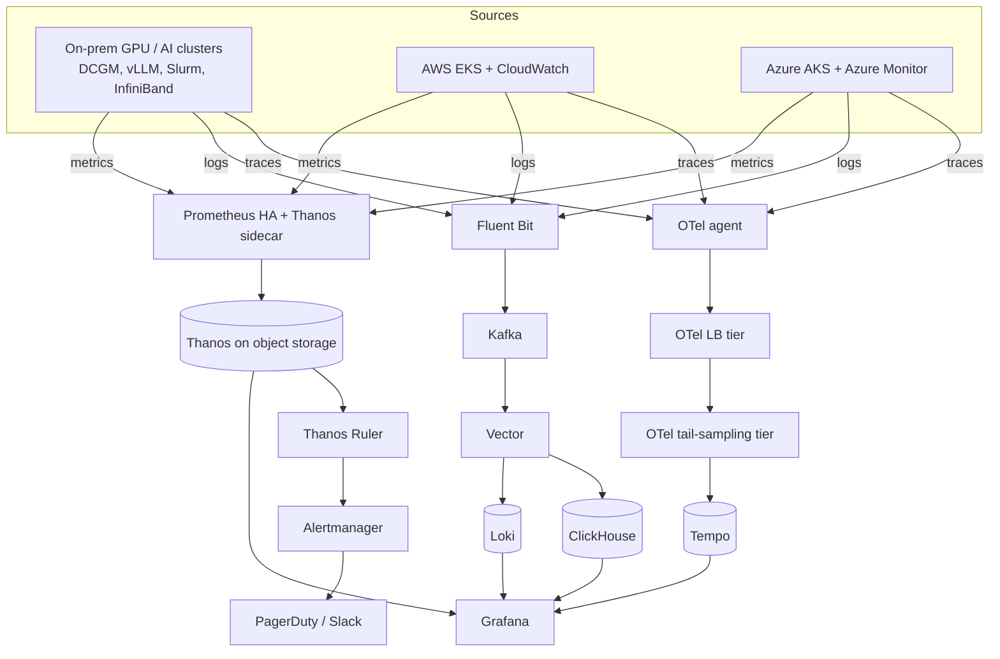

# Hybrid On-Premise AI GPU + AWS/Azure Cloud Observability Platform

Production-grade, GitOps-managed observability for **on-premise AI/GPU data center clusters**, **AWS (EKS)** and **Azure (AKS)** —
metrics, logs, traces, profiles, alerting and SLOs in one platform.

| Signal | Collect | Buffer / process | Store | View / act |
| --- | --- | --- | --- | --- |
| Metrics | Prometheus (HA pairs), NVIDIA DCGM Exporter, YACE, azure-metrics-exporter | Thanos sidecar | Thanos (S3 / Azure Blob) | Grafana, Thanos Ruler, Alertmanager |
| Logs | Fluent Bit | Kafka (Strimzi / MSK / Event Hubs), Vector | Loki (search), ClickHouse (analytics) | Grafana |
| Traces | OpenTelemetry SDKs + Operator auto-instrumentation | OTel Collector agent → LB tier → tail-sampling tier | Tempo | Grafana |
| Profiles | Pyroscope eBPF / SDKs | — | Pyroscope | Grafana |
| Alerting | Sloth SLOs, PrometheusRules | Alertmanager (3-replica cluster) | — | PagerDuty, Slack |



## Repository layout

```
.
├── terraform/            # Cloud infrastructure (AWS, Azure, PagerDuty)
│   ├── modules/          # Reusable modules
│   └── live/prod/        # Production root modules
├── ansible/              # On-prem bare-metal GPU host agents
├── gitops/               # Everything Argo CD deploys
│   ├── bootstrap/        # App-of-apps + AppProject
│   ├── applicationsets/  # One ApplicationSet per component
│   ├── values/           # Helm values per component (+ per-cluster overrides)
│   └── manifests/        # CRs: Kafka, ClickHouse, OTel, Instrumentation, secrets, policies
├── alerts/               # PrometheusRules + promtool unit tests
├── slos/                 # Sloth SLO specs
├── dashboards/           # Grafana dashboards as code (JSON)
├── charts/               # observability-onboarding Helm chart for teams
├── libs/                 # obs-py (Python) and obs-go (Go) instrumentation libraries
├── tools/                # coverage-scorecard service
├── chaos/                # Game-day experiments (Chaos Mesh)
├── loadtest/             # avalanche + k6
├── docs/                 # Design, ADRs, runbooks, rollout, conventions
└── .github/workflows/    # CI
```

## Implementation order

Follow `docs/implementation-guide.md`. Summary:

| Phase | What | Where |
| --- | --- | --- |
| 0 | Design, sizing, security, tenancy sign-off | `docs/design.md`, `docs/sizing.md`, `docs/adr/` |
| 1 | Foundation: buckets, identities, clusters, Argo CD, secrets | `terraform/`, `ansible/`, `gitops/bootstrap/` |
| 2 | Metrics: Prometheus HA, GPU Operator/DCGM, YACE, Thanos, Grafana | `gitops/applicationsets/`, `gitops/values/` |
| 3 | Logs: Fluent Bit → Kafka → Vector → Loki + ClickHouse | `gitops/manifests/kafka`, `gitops/values/vector` |
| 4 | Traces & profiles: OTel Operator, Tempo, Pyroscope | `gitops/manifests/otel` |
| 5 | Alerting, SLOs, PagerDuty, cardinality controls | `alerts/`, `slos/`, `terraform/live/prod/pagerduty` |
| 6 | Retention, lifecycle, cost, DR | `docs/retention.md`, values files |
| 7 | Gap detection & meta-monitoring | `tools/coverage-scorecard`, `alerts/meta.yaml` |
| 8 | Self-service: libraries, onboarding chart, Terraform module | `libs/`, `charts/`, `terraform/modules/cloud-account-onboarding` |
| 9 | Rollout waves & migration | `docs/rollout.md` |
| 10 | Game days & postmortems | `chaos/`, `docs/postmortems/` |
| 11 | Tool bake-offs, governance, mentoring | `docs/adr/`, `docs/review-checklist.md`, `CODEOWNERS` |
| 12 | Day-2 operations | `docs/day2-operations.md`, `renovate.json` |

## Before you start: replace placeholders

| Placeholder | Meaning |
| --- | --- |
| `asimshahibm` | GitHub account that hosts this repo (already set) |
| `example.com` | Your internal DNS domain |
| `111122223333` | AWS account ID |
| `us-east-1` / `eastus` | AWS and Azure regions |
| `acme` | Short company/platform prefix for resource names |

`grep -rn "asimshahibm\|example.com\|111122223333\|acme" .` lists every spot.

## Quick start

```bash
make check                                   # lint + validate everything locally
cd terraform/live/prod/aws && terraform init && terraform apply
cd ../azure && terraform init && terraform apply
ansible-playbook -i ansible/inventory/hosts.ini ansible/playbooks/gpu-node-observability.yml
kubectl apply -f gitops/bootstrap/                 # Argo CD takes over from here
```

## Notes
- Chart and image versions are pinned to known-good releases; Renovate opens PRs to upgrade them. Review release notes before merging major bumps.
- Clusters are registered in Argo CD with labels `obs=enabled` and `role=hub|gpu|aws|azure`; the hub cluster must be named `hub`.
- Validated locally: all YAML/JSON parses, yamllint clean, `promtool check rules` + `promtool test rules` pass, `amtool check-config` passes,
  Terraform syntax parses, obs-py tests pass. CI additionally runs `terraform validate`, tflint, checkov, helm lint, kubeconform and Go builds.
